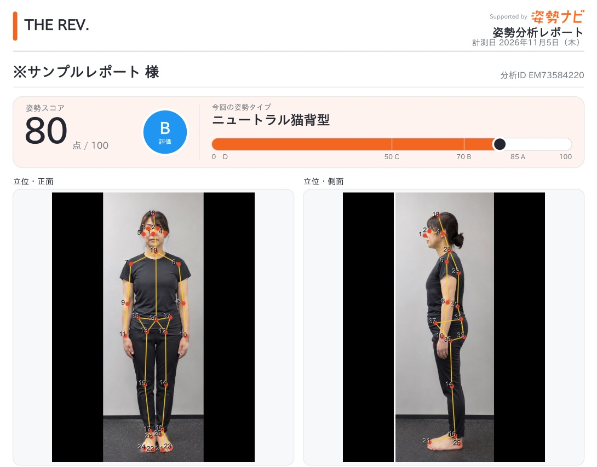

「筋トレを始めたいけれど、自分はどこを意識すればいいのだろう」。鏡を見て背中の丸まりや左右の違いが気になっても、それを運動にどうつなげるかは、一人では分かりにくいものです。

パーソナルジムでの姿勢チェックは、**今の立ち姿の特徴を見て、これからの筋トレや日常の意識を相談するきっかけ**になります。

奈良・新大宮のTHE REV. CONDITIONING LAB.では、姿勢分析ツール「姿勢ナビ」を導入しています。結果を一緒に見ながら筋肉のバランスについて話し合い、筋トレ・姿勢の意識・ストレッチを考える参考にしています。この記事では、姿勢チェックで何を見て、どのように運動の相談へつなげるのかを紹介します。

## 姿勢チェックでは、正面と横から立ち姿の特徴を見る

自分の姿勢は、いつも見ている方向だけでは気づきにくいことがあります。正面では肩の高さや身体の傾き、横からは頭や上半身の位置関係など、見る方向が変わると分かりやすくなる特徴もあります。

姿勢ナビは、正面・側面の写真をもとに、身体のポイントや傾き・左右差などをAIが推定し、画像や参考スコアで表示するツールです。言葉だけで「少し前に出ています」と伝えるよりも、**どの部分の話をしているのかを、同じ画像で確かめやすくなります**。

※架空人物を使ったサンプルレポートの一部です。掲載写真・スコアは説明用で、実際のお客様の結果や改善実績を示すものではありません。

スコアは、姿勢の特徴を共有するための目安です。点数だけで身体の良し悪しを決めたり、写真の見た目から痛みの原因を判断したりする使い方はしません。

## 結果を見ながら、筋肉のバランスについて話し合う

THE REV.で結果を確認するときは、筋肉のバランスの話を中心に、今後の運動で意識したいことを整理します。

ここでいう筋肉のバランスは、見た目の左右差だけを指すものではありません。どこを鍛えることを考えるか、姿勢を保つときに何を意識するか、ストレッチを取り入れるならどこから考えるか。姿勢の特徴を、そのような相談の材料にしていきます。

ただし、**姿勢写真だけで「この筋肉が足りない」「ここが弱い」と確定することはできません**。筋力を直接測った結果ではないためです。画像に表れた特徴と、ご本人が気になっていることをすり合わせながら、取り組み方を考えます。

例えば「背中の丸まりが気になる」という場合も、すぐに一つの種目へ決めるのではなく、普段どんな運動をしているか、どの場面で姿勢が気になるかを話すところから始められます。結果の名前を覚えることより、自分が相談したいことを具体的にするための姿勢チェックです。

## 筋トレ・日常の意識・ストレッチを組み合わせて考える

姿勢を確認したあとは、筋トレだけを増やすのか、立ち方や座り方の意識も見直すのか、ストレッチも取り入れるのかを考えます。THE REV.では、結果を参考にしながら、次の三つの方向から取り組みを相談します。

### 筋トレで、どこを意識するか

「何の種目をするか」に加えて、「その運動で何を意識したいか」も相談のポイントです。すでに筋トレをしている方なら、今のメニューや、動いていて分かりにくいことを伝えてください。これから始める方なら、気になる姿勢や目指したい身体から話せます。

姿勢のタイプが同じでも、全員に同じ筋トレを当てはめる前提にはしません。実際の運動では、無理なく行える範囲の動きも確認しながら進めます。

### 普段の生活で、何を意識するか

ジムで取り組むことと、日常で意識することをつなげる視点もあります。「仕事中に姿勢が気になる」「立っているときの身体の傾きが気になる」など、場面を添えると相談が具体的になります。

一日中、同じ姿勢で固めることを目標にする必要はありません。まずは自分が気づきやすい場面を一つ挙げ、取り入れられそうな意識を考えていきます。

### ストレッチを、どのように取り入れるか

ストレッチも、姿勢の結果を参考に検討する選択肢です。「表示された種目を全部こなす」と考えるより、目的や行いやすさを確かめ、自分が取り組める内容を相談してください。

姿勢ナビの提案は参考情報として扱い、そのまま一人ひとりへの処方とするものではありません。痛みやしびれがある場合は、姿勢チェックや運動だけで解決しようとせず、医療機関へご相談ください。

姿勢と筋トレの関係をもう少し知りたい方は、[猫背と筋トレを考えるときの基本](/blog/nekose-strength-training-posture/)も参考にしてください。

## 姿勢を見てもらいたいときは、気になる場面を一つ伝える

相談前に、専門用語で説明できるようになる必要はありません。「写真に写った横姿が気になる」「筋トレ中の姿勢を意識したい」「何を鍛えればよいか相談したい」など、ご自身の言葉で十分です。

今行っている運動があれば、その内容も相談材料になります。姿勢の写真を撮ることだけを目的にせず、**結果を見て、これから何を意識して取り組むかを話す**ところまで考えると、利用する目的がはっきりします。

THE REV.は、奈良・新大宮の完全予約制パーソナルジムです。姿勢ナビによる確認を、筋トレや身体への意識を考える補助として活用しています。

姿勢を確認しながらトレーニングについて相談したい方は、[公式LINE](https://lin.ee/UXE0bLd)で、気になっていることをお聞かせください。ご希望に合うサービス内容と予約方法をご案内します。

### 参考情報

- [姿勢ナビ公式サイト](https://shiseinavi.com/)
- [姿勢ナビ：開発元によるアプリ説明](https://play.google.com/store/apps/details?hl=ja&id=com.saucer.shiseinavi.android)

姿勢ナビは医療的な診断・治療を目的とする機器ではありません。本記事の説明は、姿勢の確認と運動の相談に関するものです。
