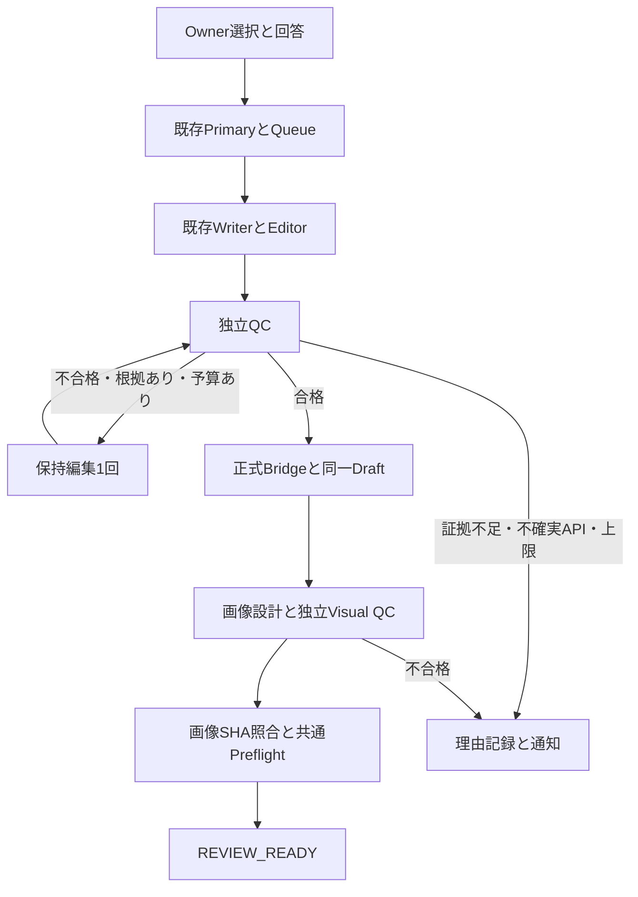

# v0.8.2 Autonomous Production Recovery 設計

既存Supervisor/Queue/Bridgeを維持する追加アダプタ。GAS sourceとONE_PASTE bundleを同時生成し、差異はCIで拒否。既定値はOFF。`THE_REV_EDITORIAL_RECOVERY_V082_MODE=ENFORCE` は本番導入時に別途確認する重要設定で、今回変更していない。

- 本文：QCにはWriter/Editor点数を見せない。4一次資料はURLの完全一致、要約、対象・限界、確認日を併送。未登録の論文URLは自動的に確認済みとしない。
- 既存REVIEW_REQUIRED原稿：承認済みOwner知識と旧独立QC不合格を確認してPrimaryから選択。Writerを再起動せず、元本文・旧QCをeditor_notes内に保持。本文QC成功をSheetsへ保存してから、欠けたGBP Draftを冪等作成し、既存Bridgeへ戻す。Google投稿はしない。
- 費用：Script PropertiesでQC2回/保持修復1回を呼出前に予約。STARTED/UNCERTAINは自動リトライしない。GBP出力はSheet書込前にcheckpoint。画像はasset契約digest付きGitHub CAS台帳に1生成・QC HTTP2件を事前予約。モデルの実usageとrequest IDを記録、取得不能な金額はnull。
- 本文証拠：独立QCが実際に読んだbody/evidence SHA256を記録。Bridgeが現在本文のhashで合格証拠を捏造し直さない。変化後は再QC。Working Draftの明示的不合格を画像ジョブで迂回できない。
- 画像：新規ジョブをstrictにし、実行器でも無料検査を必須化。過去の独立観察にfingerprintがある場合だけ再利用し、未知の履歴は推測で補わない。旧失敗版の予算は新しい自動選択でリセットできない。
- 状態：`DRAFT / QC_PASSED / IMAGE_READY / BRIDGE_SYNCED / REVIEW_READY / PUBLISHED` は既存DBのenumを破壊せず、証拠から計算する進捗。CMSのstatus=draftとは別。同期は画像より先でも、準備完了とはしない。APIとReview UIへ現在工程・停止理由・次処理・再利用成果物を返す。
- 最終受入：Thumbnail/OGP/GBPのGitHub実体、QAが見たhash、配信先GETのSHA256を一致させる。同じファイルサイズでも別画像は停止。人間のPublish APIでも同じPreflightを再実行する。
- 通知：Primaryが品質停止をQueueへ反映し、既存の重複抑止通知へ引き渡す。WatchdogにWriter/QC/画像生成権限を追加しない。

制限：汎用的な新規論文の無料自動収集・検証は未実装。根拠が足りない記事は安全停止する。Writer中のハードタイムアウトからの完全な成果物回収、全実行系を跨ぐlease、実店舗保持と人物の自然な合成を両立する次の編集方式は残課題。これらまで復旧済みとは扱わない。
